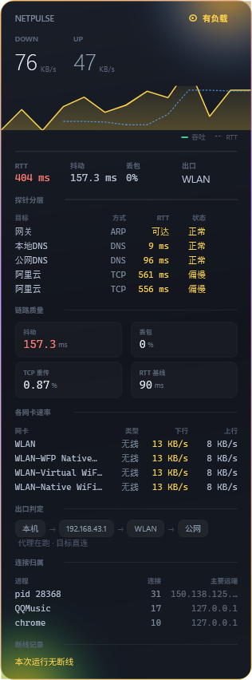

# NetPulse — 不占带宽的网络状态实时监控

针对**国内校园网 / 手机热点 + VPN（TUN 虚拟网卡）/ 系统代理** 这类环境做的实时网络体检工具。
Windows 10/11 x64，**单个 exe，双击即用，不依赖 .NET 运行时或 PowerShell**。

---

## 怎么启动

**双击 `NetPulse.exe`。**

会弹一次 UAC 授权框 → 点「是」→ 右下角出现悬浮窗。
（exe 内嵌了 `requireAdministrator` 清单，所以必定会弹一次。）

如果不想每次提权，用源码跑非提权版：

```powershell
powershell -NoProfile -ExecutionPolicy Bypass -File .\NetPulse.UI.ps1
```

### 命令行参数

```powershell
NetPulse.exe                  # 正常启动
NetPulse.exe --expanded       # 直接展开
NetPulse.exe --no-topmost     # 不置顶
```

---

## 窗口怎么用

| 操作 | 效果 |
|---|---|
| **拖动** | 按住任意空白处拖动窗口 |
| **双击** | 展开 / 收起详细面板 |
| **右键** | 展开详情 / 暂停采样 / 置顶开关 / 退出 |

收起态 316×~233，展开约 316×850。

---

## 界面



**顶部**：下行 / 上行速率，健康度状态灯。
外壳的渐变描边、背景光晕、折线颜色都跟着健康度换色相（正常绿 / 有负载琥珀 / 拥塞橙 / 丢包红 / 断线红）。

**折线图**：实线是吞吐，虚线是 RTT（展开态才有）。上限取 P90 而非最大值，避免单次突发把整条曲线压平。

**展开后六个分区**

| 分区 | 内容 |
|---|---|
| 探针分层 | 网关(ARP) → 本地DNS(UDP) → 公网DNS(UDP) → 两个国内目标(TCP)，逐层定位断在哪一段 |
| 链路质量 | 抖动 / 丢包 / TCP 重传率 / RTT 基线 |
| 各网卡速率 | 物理网卡、隧道（Wintun/Tailscale）、虚拟网卡分开统计 |
| 无线信号 | SSID、信号强度、RSSI、频段、协商速率 |
| 出口判定 | 本机 → 网关 → 出口网卡 → 公网，标出全局 / 规则 / 直连 |
| 连接归属 | 哪个进程占了多少条连接 |

---

## 为什么它几乎不占带宽

| 探针 | 单次开销 | 用途 |
|---|---|---|
| **ARP**（网关） | ≈ 0 字节，二层帧，不出本链路 | 最快的"局域网还在不在"信号 |
| **UDP DNS**（本地 + 公网各一） | 约 100 字节 | 自封包，绕过系统解析缓存 |
| **TCP SYN**（2 个国内目标） | 约 3 个包，不握手完、不发载荷 | 真实公网往返 |

1 Hz 全量监测合计约 **0.5~1 KB/s**。ARP 探针完全不产生网络流量。

---

## 为什么不用 ping

在你的机器上实测：

```
ICMP (System.Net.NetworkInformation.Ping) → 所有目标全部异常，包括网关
TCP 223.5.5.5:443     → 50 ms   ✓
TCP 119.29.29.29:443  → 超时
TCP 1.1.1.1 / 8.8.8.8 → 一直挂在 SYN_SENT
```

所以**不用 ICMP**；公网目标池启动时并行竞速，只保留当前真正连得上的（每 5 分钟复检），
通了国际就多测一条国际线，不通就不占预算。

---

## 两种实现

仓库里同时保留了 C# 版和 PowerShell 版：

| 版本 | 入口 | 说明 |
|---|---|---|
| **C#（推荐）** | `netpulse-cs/` → 编译成 `NetPulse.exe` | 单文件自包含，启动快，无脚本执行策略问题 |
| PowerShell | `netpulse/NetPulse.cmd` | 免编译，改起来方便，但依赖 PowerShell 且受执行策略影响 |

C# 版是 PowerShell 版的功能对等重写，两者界面和指标一致。

---

## 自己编译

需要 .NET 9 SDK。

```powershell
cd netpulse-cs
dotnet publish -c Release -r win-x64 --self-contained true `
  -p:PublishSingleFile=true `
  -p:IncludeNativeLibrariesForSelfExtract=true `
  -p:EnableCompressionInSingleFile=true `
  -p:DebugType=none
```

产物在 `bin/Release/net9.0-windows/win-x64/publish/NetPulse.exe`。

---

## 踩过的坑（给后来改代码的人）

1. **`MIB_IF_ROW2` 结构体在托管侧算错大小**
   257 字符的 inline 字符串字段，`Marshal.SizeOf` 返回 1296，真实是 1352。
   结果行偏移全错，读出 1.7e18 量级垃圾值。
   → 改用老的 `GetIfEntry(MIB_IFROW, 856B)`。

2. **netsh 输出编码前后不一致**
   管道捕获是 GBK，`-RedirectStandardOutput` 重定向到文件是 UTF-8，
   切 `chcp 65001` 又会变成英文输出导致中文字段直接消失。
   → 读原始字节后自动探测哪套编码能解出「信号」。

3. **WPF 自动生成的 App 入口会覆盖你的 `Main`**
   设了 `UseWPF=true` 后 SDK 会生成 `App.g.cs`，自己的 `[STAThread] Main` 被静默忽略。
   → `<EnableDefaultApplicationDefinition>false</EnableDefaultApplicationDefinition>` + `<StartupObject>`。

4. **`GridLength` 别用绝对值**
   `GridLength(1)` 是 1 像素，不是 1 份。要 `GridLength(1, GridUnitType.Star)`。

5. **每个数据行必须自带列定义**
   把 ColumnDefinitions 加在容器 Grid 上、数据行再塞进容器，
   会导致每行的子 Grid 没有列定义，所有文字堆在第 0 列、完全重叠。

6. **PowerShell 脚本必须存成带 BOM 的 UTF-8**
   否则 Windows PowerShell 5.1 按 ANSI 解析，中文全变乱码、直接语法错误。

7. **VBS 文件保持纯 ASCII**
   VBScript 按系统 ANSI 代码页读文件，UTF-8 中文注释会变乱码并破坏语法。
